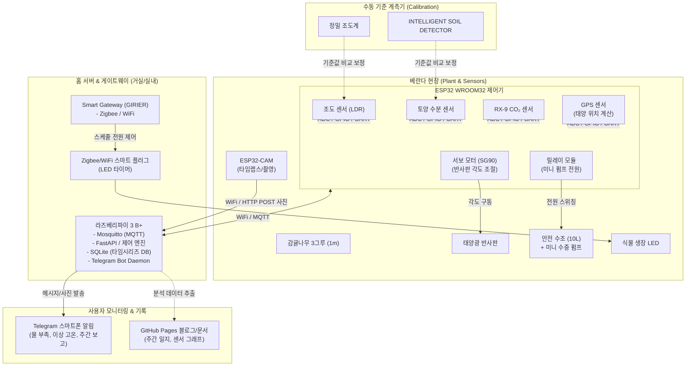

# 🏛️ 시스템 아키텍처 및 하드웨어 매핑

보유 중인 장비와 부품을 기반으로 설계한 아파트 베란다 스마트팜의 계층별 아키텍처입니다.

---

## 1. 하드웨어 구성도 & 데이터 파이프라인

---

## 2. 세부 역할 분담 및 인터페이스

### 2.1 라즈베리파이 3 B+ (중앙 서버 & 게이트웨이)
* **OS**: Raspberry Pi OS (Lite 또는 데스크톱)
* **주요 서비스**:
  * **MQTT Broker (`mosquitto`)**: ESP32 단말 및 센서 데이터 수신
  * **Data Logger & DB**: SQLite 기반 센서 로그 및 DLI(일일 적산 광량) 누적 적재
  * **Telegram Bot 서비스**: `python-telegram-bot`을 활용하여 사용자 대화형 명령(`/status`, `/photo`, `/water`) 처리 및 푸시 알림
  * **카메라 스토리지**: ESP32-CAM이 전송한 일자별 사진 아카이빙

### 2.2 ESP32 WROOM32 (베란다 엣지 제어기)
* **역할**: 베란다 극한 환경(온도 변화)에서 안정적인 센서 계측 및 액추에이터 제어
* **핀맵 및 연결**:
  * **Analog In**: 토양 수분 센서, LDR 조도 센서 (전압 분배 회로)
  * **UART**: GPS 모듈 (태양 궤적 산출용 좌표/시간), RX-9 CO₂ 센서
  * **PWM Out**: Freenove 서보 모터(SG90) 각도 제어 (반사판 틸팅)
  * **Digital Out**: 5V 릴레이 모듈 (관수 미니 펌프 제어)

### 2.3 ESP32-CAM (생육 비주얼 모니터링)
* **역할**: 감귤나무 3그루의 개화, 수분, 결실, 낙과 과정을 고해상도 사진으로 정기 기록
* **운영 모드**: 평상시 딥슬립(Deep Sleep) 상태 유지 ➡️ 매일 정해진 시각(예: 12시, 15시) 기상 ➡️ 사진 촬영 후 RPi로 HTTP POST 전송 ➡️ 다시 슬립

### 2.4 Smart Gateway (GIRIER JMWZG1) & 식물 생장 LED
* **역할**: 고와트(50~100W) 식물 생장 LED의 안전한 전원 스위칭
* **운영 방식**: 스마트 플러그를 게이트웨이에 등록하여 오후 2시~저녁 9시 보광 스케줄 자동화

---

## 3. MQTT 메시지 토픽 규격

| 토픽 (Topic) | 방향 | 페이로드(JSON) 예시 | 용도 |
| :--- | :--- | :--- | :--- |
| `citrus/sensor/telemetry` | ESP32 ➡️ RPi | `{"lux": 1540, "dli_acc": 8.4, "soil": [42, 38, 45], "co2": 480}` | 1분 주기 센서 데이터 |
| `citrus/actuator/servo` | RPi ➡️ ESP32 | `{"angle": 45}` | 태양 추적 반사판 각도 명령 |
| `citrus/actuator/pump` | RPi ➡️ ESP32 | `{"target_pot": 1, "sec": 5}` | 안전 타이머 기반 펌프 가동 |
| `citrus/alert/water` | RPi ➡️ Telegram | `{"msg": "⚠️ 2번 화분 수분 25% 도달. 물 보충 필요"}` | 긴급 알림 푸시 |
