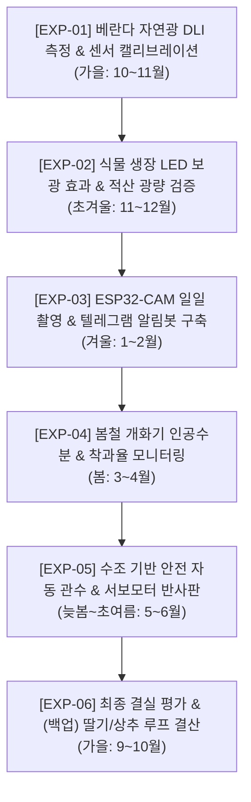

# 🧪 실험 계획 및 검증 시나리오 (1년 로드맵)

동남향 아파트 베란다에서 6년생 감귤나무 3그루의 결실을 실현하기 위한 단계별 가설 검증 실험 목록입니다.

---

## 📌 실험 로드맵 타임라인

---

## 📋 세부 실험 정의

### [EXP-01] 베란다 자연광 DLI 측정 및 센서 캘리브레이션
* **목적**: 동남향 베란다에서 오후 2시 직사광선 종료 시 하루 누적 광량이 얼마나 부족한지 정량화
* **방법**:
  1. 수동 정밀 조도계로 오전 9시~오후 5시 1시간 간격 실측
  2. Freenove LDR 센서 + ESP32 실시간 측정값과 대조하여 변환 공식 도출
  3. 일일 누적 DLI($mol/m^2/day$) 산출 (가설: 감귤 결실 기준 20 DLI 대비 40~50% 수준일 것으로 예측)
* **결과물**: 블로그 1차 분석 리포트 발행

### [EXP-02] 식물 생장 LED 보광 효과 및 타이머 최적화
* **목적**: 부족한 DLI를 채우기 위한 생장 LED의 적정 W(와트)수와 가동 시간 도출
* **방법**: 오후 2시~저녁 9시(7시간) 보광 시 화분 수관(Canopy) 기준 추가 DLI 계산 및 온도/발열 점검
* **성공 기준**: 감귤나무 잎 표면 기준 총 DLI 20 이상 달성

### [EXP-03] 토양 수분 모니터링 & Telegram 봇 연동
* **목적**: 화분 3개의 물 마름 속도 측정 및 적기 급수 알림
* **방법**:
  1. `INTELLIGENT SOIL DETECTOR` 기준값과 ESP32 토양 센서 비교 캘리브레이션
  2. 토양 수분 30% 이하 시 Telegram으로 사용자 스마트폰에 알림 메시지 발송
  3. 스마트폰에서 `/status` 전송 시 현재 온습도/수분/DLI 리포트 회신

### [EXP-04] 봄철 개화기 인공수분(Hand Pollination) & 착과 관찰
* **목적**: 아파트 실내 무풍/무곤충 환경에서의 수분 성공률 극대화
* **방법**: 개화 시 붓/면봉으로 꽃가루 수분 작업 진행, ESP32-CAM으로 매일 12시 고해상도 촬영
* **지표**: 개화 수 대비 초기 착과(어린 열매 형성) 비율

### [EXP-05] 안전 수조 기반 정량 자동 관수 & 서보 반사판
* **목적**: 누수 위험 없는 아파트 맞춤형 자동 급수 및 자연광 유입 극대화
* **방법**: 10L 밀폐 수조 + 미니 펌프 + Freenove 릴레이로 1회당 300ml 정량 급수
* **서보 반사판**: Freenove 서보모터로 반사판 각도를 조절하여 오전/정오 햇빛을 나무 하부로 투사

### [EXP-06] (백업 플랜) 딸기/상추 퀵 루프 병행 재배
* **목적**: 1년의 긴 호흡 중 빠른 수확 피드백 및 블로그 재미 확보
* **방법**: 감귤나무 하부 여유 공간에 생장 LED 빛을 공유하는 딸기/상추 소형 베드 배치
