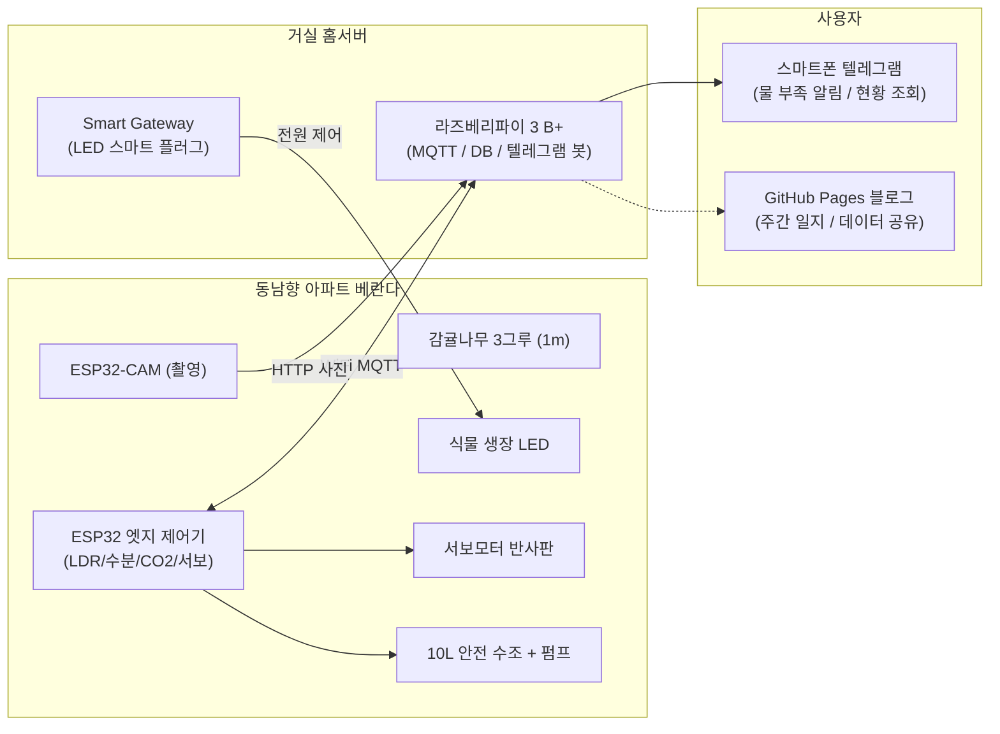

# 🍊 SmartFarm PoC: 동남향 베란다 감귤나무 결실 프로젝트

동남향 아파트 베란다에서 수령 6년차(1미터 급) **감귤나무 3종의 결실(착과)**을 목표로 하는 1개년 스마트팜 PoC 프로젝트입니다.  
오후 2시 일조 종료에 따른 광량 부족(DLI 부족)을 식물 생장 LED와 반사판으로 극복하고, 토양 수분 모니터링 및 안전한 수조식 자동 관수를 구현합니다.

---

## 🎯 핵심 목표

- **광량 부족 극복**: 식물 생장 LED 타이머 제어 및 DLI(일일 적산 광량) 실시간 계산
- **스마트 알림**: 화분 토양 수분 모니터링 및 Telegram 챗봇 물 보충 알림
- **안전한 자동 관수**: 아파트 누수 방지를 위한 **수조(물통) + 미니 펌프** 방식의 정량 급수
- **자연광 극대화**: 서보 모터를 이용한 태양 궤적 추적 반사판(Heliostat) 각도 조절 실험
- **타임랩스 기록**: ESP32-CAM을 이용한 일자별 생육 및 개화/착과 과정 시각 기록
- **백업 루프**: 감귤나무 하부 공간을 활용한 딸기/상추 퀵 피드백 병행 재배
- **돌멩이 수프 프로젝트**: 서랍 속 굴러다니던 부품으로 시작하여, 지식과 재능을 나누며 함께 키워가는 오픈 하드웨어 프로젝트

> 🍲 *"이 작은 시도가 솥에 던져 넣는 첫 번째 돌멩이가 되길 바랍니다. 누구든 아이디어와 훈수를 환영합니다!"*

---

## 🧭 바로가기

| 구분 | 설명 | 링크 |
| :--- | :--- | :--- |
| 📋 **요구사항** | 프로젝트 배경, 기능별 요구 스펙, 1개년 마일스톤 | [요구사항 문서 바로가기](requirements.md) |
| 🧰 **장비 인벤토리** | 보유 중인 RPi 3B+, ESP32, 센서, Freenove 키트 등 | [장비 인벤토리 바로가기](inventory.md) |
| 🏛️ **아키텍처** | 보유 하드웨어 매핑, 데이터 파이프라인 및 MQTT 설계 | [아키텍처 바로가기](architecture/index.md) |
| 🧪 **실험 계획** | DLI 측정부터 인공수분, 자동 관수까지 6대 실험 로드맵 | [실험 계획 바로가기](experiments/index.md) |
| 📝 **개발/실험 일지** | 작업 과정, 트러블슈팅, 주간 보고가 등록되는 블로그 | [블로그/일지 바로가기](blog/index.md) |

---

## 📊 시스템 개요 다이어그램



---

## 🚀 빠른 시작 (로컬에서 문서 사이트 확인)

```bash
# 가상환경 생성 및 의존성 설치
python3 -m venv .venv
source .venv/bin/activate
pip install -r requirements-docs.txt

# 로컬 개발 서버 실행
mkdocs serve
```

웹 브라우저에서 `http://127.0.0.1:8000`으로 접속하여 실시간 미리보기를 확인할 수 있습니다.
